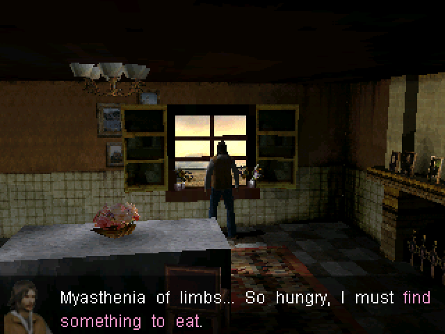
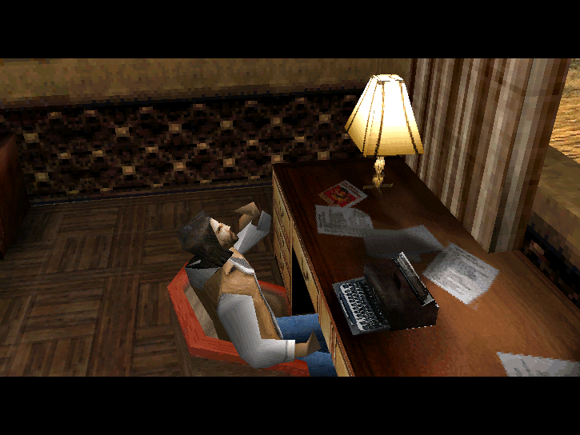
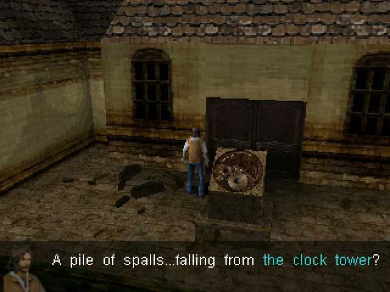
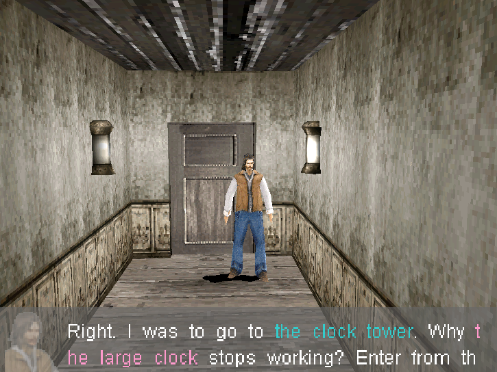

# Hebdomad: Seven Vigils

**7 Days Salvation on the Nokia N900 and PS Vita.**

An unofficial engine, rewritten with SDL3, to play *7 Days Salvation* (Symbian, 2009) on the
Nokia N900 (Maemo 5, OpenGL ES 2.0) and the PS Vita (SceGxm).

| Nokia N900 | PS Vita |
| :---: | :---: |
|  |  |
|  |  |

> **Note:** You'll need the data from your own copy of the original game (`res.spk`).
> It is not included.

## Download

Get the files from [Releases](https://github.com/0x4d696e68/Hebdomad/releases/latest):

| Platform | File |
| --- | --- |
| Nokia N900 (Maemo 5) | `hebdomad_1.1.0_armel.deb` |
| PS Vita | `hebdomad.vpk` |

## How to Install

### Nokia N900

1. Download `hebdomad_1.1.0_armel.deb` and install it as root: `dpkg -i hebdomad_1.1.0_armel.deb`
2. Copy `res.spk` to the `HebdomadSevenVigils` folder in the device memory
3. Start **Hebdomad: Seven Vigils** from the menu

### PS Vita

Needs a Vita with HENkaku / Ensō and VitaShell.

1. Download `hebdomad.vpk` and install it with VitaShell
2. Copy `res.spk` to `ux0:data/HebdomadSevenVigils/`
3. Start **Hebdomad** from the LiveArea

## Game Data (res.spk)

`res.spk` holds the graphics, sound and levels of 7 Days Salvation. Hebdomad needs it to run.

- **From a Symbian phone with the game installed:** copy `\system\apps\SevenDays\res.spk` from the
  drive the game is installed on (C: or E:).
- **From the game's .sis installer:** extract it with a SIS tool (e.g. SISContents) and take
  `res.spk` from `system\apps\SevenDays\`.

Copy `res.spk` to the `HebdomadSevenVigils` folder:

| Platform | Folder |
| --- | --- |
| Nokia N900 | `/home/user/MyDocs/HebdomadSevenVigils/` |
| PS Vita | `ux0:data/HebdomadSevenVigils/` |

## Legal

No game data is included. 7 Days Salvation belongs to its respective owners. Hebdomad is in no
way associated with or endorsed by the original developer or publisher.

---

## Tiếng Việt

**7 Days Salvation trên Nokia N900 và PS Vita.**

Engine không chính thức, viết lại bằng SDL3, để chơi *7 Days Salvation* (Symbian, 2009) trên
Nokia N900 (Maemo 5, OpenGL ES 2.0) và PS Vita (SceGxm).

> **Lưu ý:** Cần dữ liệu từ bản game gốc của bạn (`res.spk`). Repo không kèm dữ liệu game.

Tải file tại [Releases](https://github.com/0x4d696e68/Hebdomad/releases/latest).

### Cài đặt trên Nokia N900

1. Tải `hebdomad_1.1.0_armel.deb` và cài bằng root: `dpkg -i hebdomad_1.1.0_armel.deb`
2. Chép `res.spk` vào thư mục `HebdomadSevenVigils` trong bộ nhớ máy
3. Mở **Hebdomad: Seven Vigils** từ menu

### Cài đặt trên PS Vita

Cần máy đã cài HENkaku / Ensō và VitaShell.

1. Tải `hebdomad.vpk` và cài bằng VitaShell
2. Chép `res.spk` vào `ux0:data/HebdomadSevenVigils/`
3. Mở **Hebdomad** từ LiveArea

### Dữ liệu game (res.spk)

`res.spk` chứa hình ảnh, âm thanh và màn chơi của 7 Days Salvation. Hebdomad cần file này để chạy.

- **Từ điện thoại Symbian đã cài game:** chép `\system\apps\SevenDays\res.spk` trên ổ đã cài game
  (C: hoặc E:).
- **Từ file cài đặt .sis của game:** giải nén bằng công cụ đọc file SIS (ví dụ SISContents) và lấy
  `res.spk` trong thư mục `system\apps\SevenDays\`.

Chép `res.spk` vào thư mục `HebdomadSevenVigils`:

- Nokia N900: `/home/user/MyDocs/HebdomadSevenVigils/`
- PS Vita: `ux0:data/HebdomadSevenVigils/`

### Pháp lý

Không kèm dữ liệu game. 7 Days Salvation thuộc về chủ sở hữu tương ứng. Hebdomad không liên quan
và không được nhà phát triển hay nhà phát hành gốc xác nhận.

Blog: [xuongportgame.blogspot.com](https://xuongportgame.blogspot.com/2026/10/hebdomad-seven-vigils-110.html)
